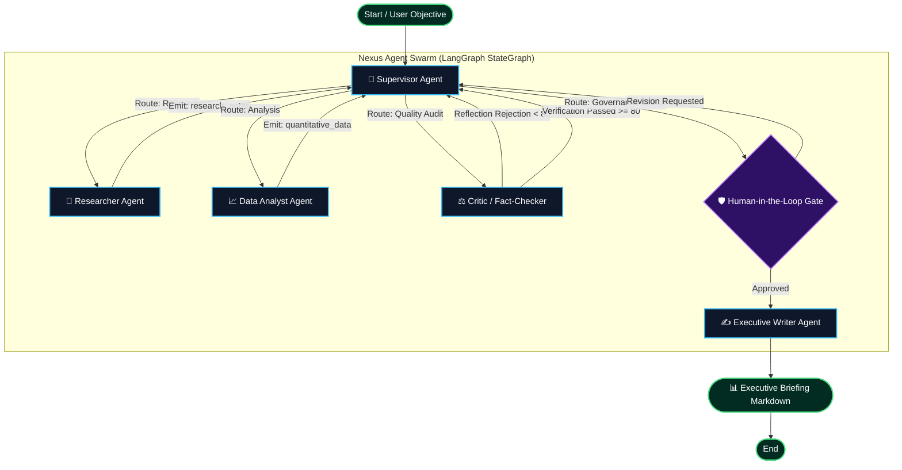

# ⚡ Nexus: Autonomous Multi-Agent Intelligence Swarm

[](https://phlppgdfry.github.io/langgraph-multi-agent-system/)
[](https://www.python.org/)
[](https://www.langchain.com/)
[](https://langchain-ai.github.io/langgraph/)
[](https://smith.langchain.com/)
[](https://sqlite.org/)
[](tests/)
[](Dockerfile)
[](notebooks/langgraph_multi_agent_masterclass.ipynb)
[](https://github.com/astral-sh/ruff)
[](LICENSE)

> 🌐 **Interactive Web Showcase & Simulator:** [phlppgdfry.github.io/langgraph-multi-agent-system](https://phlppgdfry.github.io/langgraph-multi-agent-system/)
> 
> **A production-grade, stateful multi-agent intelligence swarm built with LangGraph, LangChain Core, LangSmith observability, reflection-driven self-correction, SQLite state persistence, and Human-in-the-Loop governance.**

---

## 📌 Executive Overview

In real-world enterprise deployments, single-turn LLM chains fail because they lack state persistence, cyclical feedback, verifiable audit trails, and human oversight. 

**Nexus** demonstrates how to build an enterprise-grade autonomous multi-agent system utilizing **LangGraph's cyclically directed state graphs** and **LangChain's unified tool abstractions**. The system coordinates a team of specialized agents that gather live intelligence, extract quantitative KPIs, cross-verify assertions, execute reflection self-correction loops, and generate executive-ready decision briefings.

Full distributed tracing, token consumption, and run trees are piped directly to **LangSmith** for enterprise observability and latency profiling.

```
       [Objective / Prompt]
                 │
                 ▼
       ┌───────────────────┐
       │ 🧭 Supervisor     │◄───────────────────┐
       └─────────┬─────────┘                    │
                 │ (Dynamic Planning & Routing) │ (Self-Correction & Updates)
                 ▼                              │
       ┌───────────────────┐                    │
       │ 🔬 Researcher     │────────────────────┤
       └─────────┬─────────┘                    │
                 ▼                              │
       ┌───────────────────┐                    │
       │ 📈 Data Analyst   │────────────────────┤
       └─────────┬─────────┘                    │
                 ▼                              │
       ┌───────────────────┐                    │
       │ ⚖️ Critic Agent   │────[Score < 80]────┘
       └─────────┬─────────┘
                 │ [Score >= 80]
                 ▼
       ┌───────────────────┐
       │ 🛡️ Human Gate     │ (Checkpointed Approval / State Rewind)
       └─────────┬─────────┘
                 ▼
       ┌───────────────────┐
       │ ✍️ Executive Writer│
       └─────────┬─────────┘
                 ▼
       [📊 Strategic Briefing .md]
```

---

## 🏗️ Multi-Agent Architecture



### Specialized Agents

| Agent | Core Responsibility | Capabilities & Tools |
| :--- | :--- | :--- |
| **🧭 Supervisor** | Dynamic Workflow Orchestration | Task decomposition, 4-phase planning, state routing, and revision cycle tracking. |
| **🔬 Researcher** | Primary Intelligence Gathering | Web search (`search_web`), snippet curation, source triangulation, and fact retrieval. |
| **📈 Analyst** | Quantitative & Metric Extraction | Financial KPI parsing (`extract_metrics`), latency/accuracy calculations, and scorecarding. |
| **⚖️ Critic** | Reflection & Quality Assurance | Multi-source verification (`verify_claim`), rigor scoring (0-100), and self-correction loops. |
| **🛡️ Human Gate** | Governance & Checkpoint Oversight | Human-in-the-loop interruption via SQLite `SqliteSaver` checkpoints before publication. |
| **✍️ Writer** | Executive Briefing Synthesis | C-suite markdown reporting with TL;DR, methodology, quantitative scorecards, and citations. |

---

## 🔍 LangSmith Tracing & Observability

Nexus is pre-instrumented for **LangSmith** out-of-the-box. Every agent action, tool invocation, token spend, latency metric, and reflection cycle is captured in an auditable trace tree.

```
Run: nexus-multi-agent-system [Status: SUCCESS]
├── supervisor [ChatOpenAI] (latency: 142ms, tokens: 380)
│   └── Input: "Analyze enterprise multi-agent adoption..."
│   └── Output: "[Supervisor] Plan initialized: 4 steps..."
├── researcher (latency: 410ms)
│   └── Tool: search_web(query="...") [HTTP 200 OK]
├── analyst (latency: 88ms)
│   └── Tool: extract_metrics(...) [4 benchmarks extracted]
├── critic (latency: 165ms)
│   └── Tool: verify_claim(...) [Quality Score: 96/100, PASSED]
└── writer [ChatOpenAI] (latency: 520ms, tokens: 1,120)
    └── Output: "# Strategic Intelligence Briefing..."
```

### Quick Setup:
Run the interactive configuration wizard:
```bash
uv run python -m langgraph_multi_agent_system.cli --configure
```
Or set `.env`:
```ini
LANGCHAIN_TRACING_V2=true
LANGCHAIN_ENDPOINT="https://api.smith.langchain.com"
LANGCHAIN_API_KEY=lsv2_pt_your_langsmith_api_key_here
LANGCHAIN_PROJECT="nexus-multi-agent-system"
```
*Read the complete [LangSmith Observability Guide](docs/LANGSMITH_GUIDE.md).*

---

## ⚡ Quickstart

### 1. Prerequisites
- Python 3.11+
- [`uv`](https://docs.astral.sh/uv/) (recommended ultra-fast package manager)

### 2. Clone & Sync
```bash
git clone https://github.com/phlppgdfry/langgraph-multi-agent-system.git
cd langgraph-multi-agent-system

# Install dependencies in under 2 seconds with uv
uv sync
```

### 3. Run via Rich Interactive CLI
```bash
# Run with default enterprise research prompt:
uv run python -m langgraph_multi_agent_system.cli

# Or specify a custom strategic prompt:
uv run python -m langgraph_multi_agent_system.cli "Analyze AI Agent ROI in Multimodal Freight Logistics"

# Enable Human-in-the-Loop checkpoint review before report publication:
uv run python -m langgraph_multi_agent_system.cli "Enterprise Agentic FinOps" --human-approval

# Save the generated markdown briefing:
uv run python -m langgraph_multi_agent_system.cli "LangGraph vs Linear Chains" -o briefing.md
```

### 4. Run via Streamlit Web Dashboard
```bash
uv run streamlit run src/langgraph_multi_agent_system/app.py
```
Open [http://localhost:8501](http://localhost:8501) to interact with the swarm in real-time, view live node progression, inspect critique scores, and download executive briefings.

### 5. Inspect in LangGraph Studio
Native integration via `langgraph.json`:
```bash
langgraph dev
```

### 6. Run Automated LangSmith Evaluation Suite
```bash
uv run python -m langgraph_multi_agent_system.cli --evals
```

---

## 📑 Sample Executive Briefings

Pre-generated reports produced autonomously by Nexus are available under [`examples/reports/`](examples/reports/):

- [📊 LangGraph Stateful Multi-Agent Orchestration Benchmarks](examples/reports/langgraph_stateful_orchestration_benchmarks.md)
- [🚢 Autonomous AI Agent Swarms in Global Supply Chain Operations](examples/reports/autonomous_supply_chain_intelligence.md)
- [💰 Enterprise FinOps & Governance for AI Agent Swarms](examples/reports/enterprise_agentic_finops_governance.md)

---

## 🧪 Testing & Code Quality

The repository maintains 100% pass rates across unit tests and linter checks:

```bash
# Run pytest test suite (8 tests)
uv run pytest -v

# Run ruff code linter
uv run ruff check .
```

---

## 📂 Repository Structure

```
langgraph-multi-agent-system/
├── .github/
│   └── workflows/
│       └── ci.yml              # Multi-Python (3.11, 3.12, 3.13) GitHub Actions CI
├── data/
│   └── swarm_checkpoints.db    # SQLite persistence database (thread replay)
├── docs/
│   ├── ARCHITECTURE.md         # Deep-dive into StateGraph, routing & memory
│   ├── LANGSMITH_GUIDE.md      # Tracing setup, eval runs & latency analysis
│   └── HUMAN_IN_THE_LOOP.md    # Checkpointing, interruption gates & state rewind
├── examples/
│   └── reports/                # Pre-generated sample executive briefings
├── src/
│   └── langgraph_multi_agent_system/
│       ├── __init__.py         # Package exports
│       ├── state.py            # TypedDict global state schema (MessagesState)
│       ├── tools.py            # Search, metric extraction & verification tools
│       ├── checkpoint.py       # Unified SQLite & MemorySaver checkpointer
│       ├── graph.py            # StateGraph topology & conditional routers
│       ├── cli.py              # Interactive Rich terminal runner & config wizard
│       ├── app.py              # Interactive Streamlit Web UI
│       ├── agents/
│       │   ├── supervisor.py   # Master orchestration agent
│       │   ├── researcher.py   # Research & source gathering
│       │   ├── analyst.py      # Quantitative extraction
│       │   ├── critic.py       # Reflection & self-correction scoring
│       │   ├── human_gate.py   # Human-in-the-loop checkpoint gate
│       │   └── writer.py       # Executive report generator
│       └── evals/
│           └── run_evals.py    # Automated LangSmith evaluation suite
├── tests/
│   ├── test_graph.py           # Integration, persistence & execution tests
│   └── test_tools.py           # Tool unit tests
├── scripts/
│   └── export_graph.py         # Mermaid topology exporter
├── langgraph.json              # LangGraph Studio configuration
├── pyproject.toml              # Modern uv / pip project metadata
├── .env.example                # Environment variable configuration guide
├── LICENSE                     # MIT License
└── README.md                   # Project documentation
```

---

## 💡 Key Architectural Patterns

1. **Stateful Graph Orchestration (`StateGraph`):** Replaces linear chains with inspectable, cyclical state machines.
2. **Reflection & Self-Correction:** Factual scoring that redirects deficient outputs back to researchers before user delivery.
3. **Deterministic Zero-Key Demo Mode:** Built with resilient fallbacks so reviewers can clone and run tests/demos without needing paid API credits.
4. **State Persistence (`SqliteSaver`):** Checkpointed state transitions allowing step replay, thread resumption, and human intervention.
5. **Observability First:** Deep LangSmith tracing for enterprise auditability and latency profiling.

---

## 👤 Author

**Philippe Godfroy**  
- GitHub: [@phlppgdfry](https://github.com/phlppgdfry)  
- Email: philippe.godfroy@hotmail.com  

---

## 📄 License

This project is licensed under the [MIT License](LICENSE).
