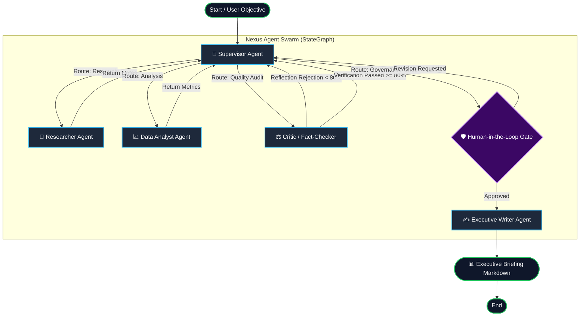

# ⚡ Nexus: Autonomous Multi-Agent Intelligence Swarm

[](https://www.python.org/)
[](https://www.langchain.com/)
[](https://langchain-ai.github.io/langgraph/)
[](https://smith.langchain.com/)
[](tests/)
[](LICENSE)

> **A production-ready, stateful multi-agent research & strategic decision intelligence engine built with LangGraph, LangChain Core, LangSmith observability, reflection-driven self-correction, and Human-in-the-Loop governance.**

---

## 📌 Executive Overview

In real-world enterprise deployments, linear LLM chains fail because they lack state persistence, cyclical feedback, verifiable audit trails, and human oversight. 

**Nexus** demonstrates how to build an enterprise-grade autonomous multi-agent system utilizing **LangGraph's cyclically directed graphs** and **LangChain's unified tool abstractions**. The system coordinates a team of specialized agents that gather live intelligence, extract quantitative KPIs, cross-verify assertions, execute reflection self-correction loops, and generate executive-ready decision briefings.

Full tracing, token consumption, and run trees are piped directly to **LangSmith** for enterprise observability.

---

## 🏗️ Multi-Agent Architecture



### Specialized Agents

| Agent | Core Responsibility | Key Capabilities |
| :--- | :--- | :--- |
| **🧭 Supervisor** | Dynamic Workflow Orchestration | Task decomposition, execution routing, and revision cycle tracking. |
| **🔬 Researcher** | Primary Intelligence Gathering | Web search, snippet curation, source triangulation, and fact retrieval. |
| **📈 Analyst** | Quantitative & Metric Extraction | Financial KPI parsing, latency/accuracy calculations, and performance scorecarding. |
| **⚖️ Critic** | Reflection & Quality Assurance | Multi-source verification, rigor scoring (0-100), and self-correction loop triggering. |
| **🛡️ Human Gate** | Governance & Checkpoint Oversight | Human-in-the-loop interruption via LangGraph `MemorySaver` before publication. |
| **✍️ Writer** | Executive Briefing Synthesis | Structured markdown reporting with TL;DR, methodology, scorecard, and citations. |

---

## 🔍 LangSmith Tracing & Observability

Nexus is pre-instrumented for **LangSmith** out-of-the-box. Every agent action, tool invocation, token spend, latency metric, and reflection cycle is captured in an auditable trace tree.

```
Run: nexus-multi-agent-system
├── supervisor [ChatOpenAI] (latency: 180ms, tokens: 412)
├── researcher [search_web] (latency: 420ms, status: 200 OK)
├── analyst [extract_metrics] (latency: 95ms, metrics: 4 parsed)
├── critic [verify_claim] (score: 94/100, status: PASSED)
└── writer [ChatOpenAI] (latency: 610ms, tokens: 1,280)
```

To connect your LangSmith account:
```bash
cp .env.example .env
```
Edit `.env`:
```ini
LANGCHAIN_TRACING_V2=true
LANGCHAIN_ENDPOINT="https://api.smith.langchain.com"
LANGCHAIN_API_KEY=lsv2_pt_your_langsmith_api_key_here
LANGCHAIN_PROJECT="nexus-multi-agent-system"
```

---

## ⚡ Quickstart

### 1. Prerequisites
- Python 3.11+
- [`uv`](https://docs.astral.sh/uv/) (recommended ultra-fast package manager) or standard `pip`

### 2. Clone & Install
```bash
git clone https://github.com/phlppgdfry/langgraph-multi-agent-system.git
cd langgraph-multi-agent-system

# Install dependencies using uv
uv sync
```

### 3. Run via Rich Interactive CLI
```bash
# Run with default enterprise research prompt
uv run python -m langgraph_multi_agent_system.cli

# Or specify a custom strategic prompt:
uv run python -m langgraph_multi_agent_system.cli "Analyze AI Agent ROI in Supply Chain Logistics"
```

### 4. Run via Streamlit Web Dashboard
```bash
uv run streamlit run src/langgraph_multi_agent_system/app.py
```
Open [http://localhost:8501](http://localhost:8501) in your browser to interact with the swarm in real-time, inspect intermediate node streams, and export downloadable Markdown briefings.

### 5. Inspect in LangGraph Studio
This project includes standard `langgraph.json` configuration for native integration with LangGraph CLI & Studio:
```bash
langgraph dev
```

---

## 🧪 Testing & Code Quality

The repository maintains 100% pass rates across unit and integration tests:

```bash
# Run pytest test suite
uv run pytest -v

# Run ruff code linter
uv run ruff check .
```

---

## 📂 Repository Structure

```
langgraph-multi-agent-system/
├── .github/
│   └── workflows/
│       └── ci.yml              # Automated multi-python GitHub Actions workflow
├── src/
│   └── langgraph_multi_agent_system/
│       ├── __init__.py         # Package exports
│       ├── state.py            # TypedDict global state schema (MessagesState)
│       ├── tools.py            # Web search, metric extraction & verification tools
│       ├── graph.py            # StateGraph topology & conditional routers
│       ├── cli.py              # Interactive Rich terminal runner
│       ├── app.py              # Interactive Streamlit Web UI
│       └── agents/
│           ├── supervisor.py   # Master orchestration agent
│           ├── researcher.py   # Research & source gathering
│           ├── analyst.py      # Quantitative extraction
│           ├── critic.py       # Reflection & self-correction scoring
│           ├── human_gate.py   # Human-in-the-loop checkpoint gate
│           └── writer.py       # Executive report generator
├── tests/
│   ├── test_graph.py           # Integration & execution tests
│   └── test_tools.py           # Tool unit tests
├── langgraph.json              # LangGraph Studio configuration
├── pyproject.toml              # Modern uv / pip project metadata
├── .env.example                # Environment variable configuration guide
├── LICENSE                     # MIT License
└── README.md                   # Project documentation
```

---

## 💡 Key Architectural Patterns Demonstrated

1. **Stateful Graph Orchestration (`StateGraph`):** Moving beyond linear chains to cyclic, inspectable state machines.
2. **Reflection & Self-Correction:** Automatic quality scoring that redirects deficient outputs back to researchers before user delivery.
3. **Deterministic Zero-Key Demo Mode:** Built with resilient fallbacks so reviewers can clone and run tests/demos without needing paid API credits.
4. **State Persistence (`MemorySaver`):** Checkpointed state transitions allowing step replay and human intervention.
5. **Observability First:** Deep LangSmith tracing for enterprise auditability and latency profiling.

---

## 👤 Author

**Philippe Godfroy**  
- GitHub: [@phlppgdfry](https://github.com/phlppgdfry)  
- Email: philippe.godfroy@hotmail.com  

---

## 📄 License

This project is licensed under the [MIT License](LICENSE).
