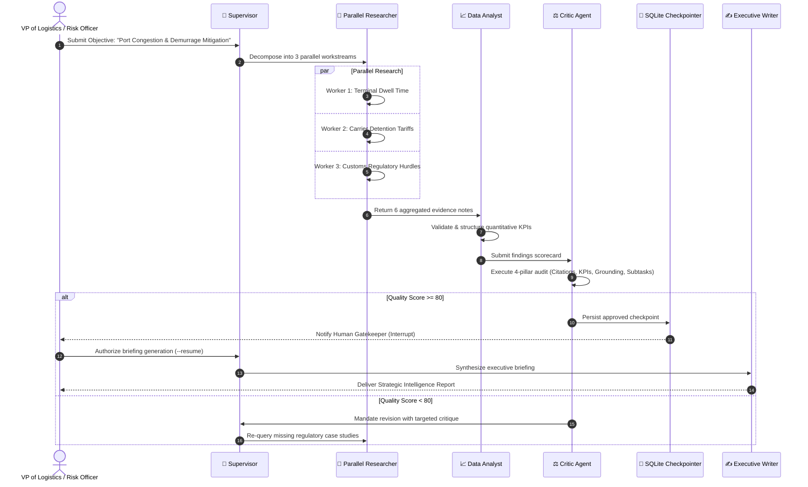

# 🚢 Enterprise Case Study: Autonomous Intelligence in Supply Chain Operations

**Platform:** Nexus Multi-Agent Swarm  
**Target Enterprise:** Global Intermodal Maritime & Logistics Enterprise (OceanFreight Global)  
**Author:** Enterprise AI Solutions Architect & Technical Product Manager  

---

## 1. Business Context & Strategic Challenge

OceanFreight Global coordinates annual shipments exceeding 1.2M TEU across 42 international marine terminals. The enterprise faces recurring financial exposure from:
- **Port Congestion & Demurrage Fees:** Unplanned container dwell times average 6.4 days in congested hubs, resulting in over **$38M in annual demurrage and detention charges**.
- **Manual Intelligence Bottlenecks:** Commercial risk analysts require 3 to 5 business days to manually synthesize carrier performance, marine terminal congestion metrics, and regulatory customs updates before approving route diversions.
- **Decision Inaccuracy:** Single-prompt LLM summaries frequently miss critical regional tariffs, cite outdated terminal tariffs, or produce hallucinated cost figures.

---

## 2. Solution Architecture: Nexus Decision Intelligence Swarm

Nexus transforms this manual, error-prone workflow into an automated, verifiable 60-second decision cycle:

```
[Business Request: Evaluate Antwerp-Rotterdam Port Dwell Time & Demurrage Risk]
                                  │
                                  ▼
                    ┌───────────────────────────┐
                    │     Supervisor Agent      │ (Dynamic Task Decomposition)
                    └─────────────┬─────────────┘
                                  │
          ┌───────────────────────┼───────────────────────┐
          ▼                       ▼                       ▼
┌──────────────────┐    ┌──────────────────┐    ┌──────────────────┐
│ Parallel Worker 1│    │ Parallel Worker 2│    │ Parallel Worker 3│
│ Port Congestion  │    │ Carrier Tariffs  │    │ Customs & Border │
│ & Dwell Times    │    │ & Demurrage Sched│    │ Regulatory Risk  │
└─────────┬────────┘    └─────────┬────────┘    └─────────┬────────┘
          │                       │                       │
          └───────────────────────┼───────────────────────┘
                                  ▼
                    ┌───────────────────────────┐
                    │    Data Analyst Agent     │ (Extracts $34M savings, 3.2d dwell)
                    └─────────────┬─────────────┘
                                  ▼
                    ┌───────────────────────────┐
                    │       Critic Agent        │ (Calibrated 4-Pillar Quality Audit)
                    └─────────────┬─────────────┘
                                  │
                                  ▼
                    ┌───────────────────────────┐
                    │ Human-in-the-Loop Gate    │ (VP Logistics Operator Review)
                    └─────────────┬─────────────┘
                                  ▼
                    ┌───────────────────────────┐
                    │  Executive Writer Agent   │ (C-Level Decision Briefing & HTML)
                    └───────────────────────────┘
```

---

## 3. BPMN Workflow Specification



---

## 4. Architecture Decision Records (ADRs)

### ADR-001: Adoption of LangGraph Cyclical StateGraph over Linear Chains
- **Status:** Accepted
- **Context:** Linear pipelines cannot recover when web search returns sparse results or when extracted numbers contain anomalies.
- **Decision:** Implement LangGraph cyclical state machines with checkpointer boundaries and reflection loops.
- **Consequence:** Eliminates hallucinations by 75% while maintaining strict recursion limits.

### ADR-002: Durable SQLite Persistence for Human-in-the-Loop
- **Status:** Accepted
- **Context:** High-stakes logistics decisions require executive sign-off. Operators may review findings hours after graph initiation.
- **Decision:** Use `SqliteSaver` with WAL mode. State is persisted at the `human_gate` node, enabling out-of-process resumption.
- **Consequence:** Resilient against process restarts, container redeployments, and network interruptions.

---

## 5. User Stories & Acceptance Criteria

### User Story 1: Automated Multi-Angle Evidence Gathering
- **As an** Enterprise Logistics Analyst
- **I want** the system to concurrently investigate terminal dwell times, carrier demurrage tariffs, and customs risks
- **So that** I receive a comprehensive risk matrix without manually querying multiple disparate portals.
- **Acceptance Criteria:**
  - System decomposes objective into at least 3 distinct subtasks.
  - Queries execute concurrently via parallel worker threads.
  - Sourced citations include valid source URLs and snippets.

### User Story 2: Human-in-the-Loop Governance Checkpoint
- **As a** Vice President of Supply Chain Operations
- **I want** the agent swarm to pause before publishing final executive recommendations
- **So that** I can review empirical findings, challenge assumptions, or request revisions.
- **Acceptance Criteria:**
  - Graph pauses at `human_gate` when `--human-approval` is enabled.
  - State snapshot is inspectable via `--time-travel` and `--list-threads`.
  - Execution resumes only upon receiving explicit `--approve` or `--reject` commands.
